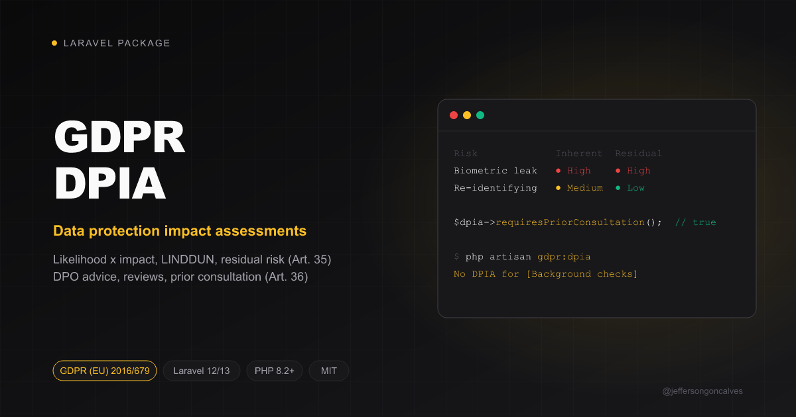

# Laravel GDPR DPIA



[](https://packagist.org/packages/jeffersongoncalves/laravel-gdpr-dpia)
[](https://github.com/jeffersongoncalves/laravel-gdpr-dpia/actions/workflows/tests.yml)
[](https://packagist.org/packages/jeffersongoncalves/laravel-gdpr-dpia)

Data protection impact assessments (DPIA) for the EU General Data Protection Regulation (GDPR, Art. 35). It is part of the [laravel-gdpr](https://github.com/jeffersongoncalves/laravel-gdpr) suite. Each assessment can be linked to a processing activity from [laravel-gdpr-records](https://github.com/jeffersongoncalves/laravel-gdpr-records).

- **Describe the processing:** what it does, the data it collects, and why that data is necessary and proportionate.
- **Score the risks:** each risk gets a likelihood and an impact from 1 to 3, both before and after the mitigation measures. A [LINDDUN](https://linddun.org) threat category is optional.
- **Get the DPO's advice, then approve:** the controller must seek it (Art. 35(2)). Approving schedules the next review (Art. 35(11)). Editing an approved assessment sends it back to draft.
- **Prior consultation:** when a high risk remains after the measures, consult the supervisory authority before processing (Art. 36(1)).
- **Find the gaps:** see which processing activities with special categories (Art. 9) or criminal data (Art. 10) have no assessment yet, the case of Art. 35(3)(b).

> This package gives you tooling. It does not make you compliant on its own. Your assessments need legal review.

## Installation

```bash
composer require jeffersongoncalves/laravel-gdpr-dpia
php artisan vendor:publish --tag="gdpr-records-migrations"   # if not published yet
php artisan vendor:publish --tag="gdpr-dpia-migrations"
php artisan migrate
```

## Usage

```php
use JeffersonGoncalves\GdprDpia\Models\ImpactAssessment;

$dpia = ImpactAssessment::create([
    'title' => 'Telemedicine appointments',
    'processing_activity_id' => $telemedicine->id,
    'description' => 'Video appointments; we store the diagnosis and prescriptions.',
    'necessity' => 'Only data needed for the appointment; recordings are not kept.',
    'risks' => [
        [
            'title' => 'Diagnosis leak',
            'threat' => 'data_disclosure',
            'likelihood' => 2, 'impact' => 3,                     // high
            'measures' => 'Encryption at rest, role-based access',
            'residual_likelihood' => 1, 'residual_impact' => 3,   // medium
        ],
    ],
    'dpo_opinion' => 'Acceptable with the listed measures.',
]);

$dpia->scoredRisks();                 // each risk with its level and residual_level
$dpia->highestRisk();                 // RiskLevel::Medium (residual)
$dpia->highestRisk(residual: false);  // RiskLevel::High

$dpia->approve('Anna Schmidt (DPO)');    // status approved, next_review_at = now + 1 year
$dpia->isReviewDue();
ImpactAssessment::query()->scopes('dueForReview')->get();
$dpia->requiresPriorConsultation();  // true when the highest residual risk is high (Art. 36)
```

A risk's level is likelihood × impact: 1–2 is low, 3–4 is medium and 6–9 is high. When you leave out the residual scores, the residual level is the inherent one. You need at least one risk to approve. Changing the title, activity, description, necessity, risks or DPO opinion of an approved assessment sends it back to draft. Approve it again after the review.

Threats (`Threat` enum, LINDDUN): `linking`, `identifying`, `non_repudiation`, `detecting`, `data_disclosure`, `unawareness`, `non_compliance`.

### Which activities need one

```php
use JeffersonGoncalves\GdprDpia\Facades\GdprDpia;

GdprDpia::candidates();
// [['activity' => ProcessingActivity, 'reasons' => ['special_categories']], ...]
```

An activity is listed when it has no assessment and one of its models declares a `DataCategory::Special` (`special_categories`) or `DataCategory::Criminal` (`criminal_data`) column. Any other high-risk processing still needs your own judgment: profiling with significant effects and systematic monitoring of public areas (Art. 35(3)(a) and (c)), and the criteria in your supervisory authority's list (Art. 35(4)).

## Report

```bash
php artisan gdpr:dpia          # assessments with inherent/residual risk and next review, then the gaps
php artisan gdpr:dpia --json   # every assessment, ready to hand to the supervisory authority
```

```php
GdprDpia::export($dpia);   // one assessment as an array
```

## Testing

```bash
composer test
```

## Changelog

See [CHANGELOG](CHANGELOG.md).

## License

The MIT License (MIT). See [License File](LICENSE.md).
